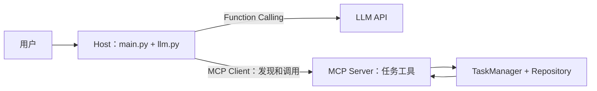

# MCP 学习笔记

## 当前 Agent 的工具调用

- `main.py` 是应用入口，调用 `ask_llm_with_tools`。
- `llm.py` 把工具定义发给模型，处理模型返回的 `tool_calls`，再把工具结果交回模型。
- `tools.py` 定义当前模型使用的工具描述，并通过 `TOOL_HANDLERS` 找到 Python 处理函数。
- 处理函数调用 `TaskManager` 执行任务业务操作。

## 接入 MCP 后的职责

- Host：继续承载应用入口、Agent 循环和模型调用。
- MCP Client：发现 MCP Server 提供的工具，并向 Server 发起调用。
- MCP Server：注册和执行任务工具，调用 `TaskManager` 完成业务操作。
- MCP Server 使用 MCP 工具描述；Host 将发现的工具转换成模型 API 所需的工具格式。

## 调用链

用户请求
→ Host 调用模型
→ 模型返回工具调用
→ MCP Client 调用 MCP Server
→ MCP Server 调用任务处理函数和 TaskManager
→ 工具结果返回 Host
→ Host 把结果交给模型生成最终回答

## MCP 解决的问题

MCP 为 AI 应用连接外部工具和上下文能力提供统一接口，让 Host 能发现并调用不同 Server 提供的能力。

## MCP 与直接 Function Calling

- 直接 Function Calling：应用把工具 schema 发给模型，再由应用代码解析模型返回的工具调用并执行。
- MCP：通过标准协议让 Host 发现并调用 Server 提供的工具；Host 仍可把这些工具转成模型 API 所需的 schema。
- 两者关系：Function Calling 负责模型与应用之间的工具调用表达；MCP 负责 Host 与外部工具服务之间的标准化连接。MCP 补充这条链路，不取代 Function Calling。

## Day 32：把现有 Agent 接入 MCP

### 当前调用链

- `main.py` 在每条用户请求中创建 MCP Client，并在这次 Agent 工具调用循环结束后关闭连接。
- `llm.py` 调用 `discover_openai_tools()`，从 Server 动态发现工具，再把 MCP schema 转成模型所需的 Function Calling schema。
- 模型仍通过 `tool_calls` 表达工具调用；Host 用 `call_mcp_tool()` 将调用转发给 MCP Server，并把结果连同 `tool_call_id` 交还模型。
- `mcp_server.py` 暴露 `get_tasks`、`create_task`、`complete_task`，并由 `TaskManager` 执行业务操作。
- 写操作由 Server 端的 `MCP_ALLOW_WRITES` 控制，默认拒绝。

### 直接 Function Calling 与 MCP 的取舍

| 维度 | 直接 Function Calling | MCP |
|---|---|---|
| 工具定义 | Host 自己维护 schema | Host 从 MCP Server 发现 schema |
| 工具执行 | Host 直接分发到 Python 函数 | MCP Client 将调用转发给 Server |
| 复用方式 | 通常绑定当前应用 | 多个支持 MCP 的 Host 可以连接同一个 Server |
| 适用场景 | 工具少、应用单一、希望减少组件 | 工具要跨应用复用，或需要统一连接不同工具服务 |
| 额外成本 | 需要维护 schema 和分发代码 | 需要管理 Client、Server、进程连接和权限 |

MCP 增加了一层协议和服务管理成本。工具只服务于单个应用时，直接 Function Calling 通常更简单；当多个 Host 需要复用同一组工具时，MCP 的标准接口更有价值。

### Day 32 验证记录

- `uv run pytest`：46 项测试通过。
- 运行 Agent 查询任务：模型通过 MCP 调用 `get_tasks`，并根据工具结果回答。
- 未设置 `MCP_ALLOW_WRITES` 时尝试创建任务：Server 拒绝写操作，Agent 如实告知失败。
- 随后重新读取任务：总数仍为 61，确认被拒绝的创建操作没有修改数据。
